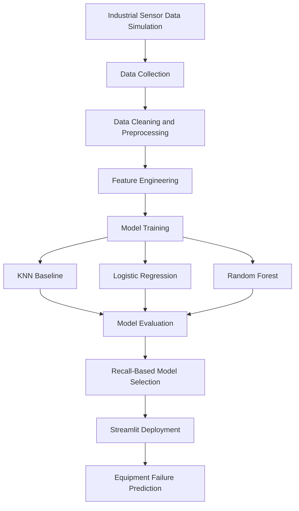

# 🚀 Predictive Maintenance System Using Machine Learning

<p align="center">
  
</p>

<p align="center">
  <b>An Intelligent Machine Learning System for Predicting Equipment Failures Before They Happen.</b>
</p>

<p align="center">
  
  
  
  
  
</p>

<p align="center">
  <a href="https://github.com/vathsalvathsa/predictive-maintenance-ml">
    
  </a>
  
  
  
</p>

---

## 📌 Project Overview

Unexpected equipment failures can cause production downtime, maintenance expenses, and operational inefficiencies.

This project develops a **Machine Learning-Based Predictive Maintenance System** that analyzes simulated industrial sensor data to predict the likelihood of equipment failure 24 hours in advance.

The system implements and compares three classification algorithms:

- **K-Nearest Neighbors (KNN)** – Baseline classification model.
- **Logistic Regression** – Statistical classification approach.
- **Random Forest** – Ensemble learning approach.

The models are evaluated using classification performance metrics, with **Recall** used as the primary model selection criterion to prioritize failure detection.

The selected model is integrated into an interactive Streamlit application for accessible equipment failure predictions.

## 🎯 Project Objectives

- Develop a predictive maintenance model using machine learning.
- Simulate industrial sensor data for equipment monitoring.
- Compare KNN, Logistic Regression, and Random Forest.
- Evaluate models using Accuracy, Precision, Recall, and F1-score.
- Prioritize failure detection through recall-based model selection.
- Deploy the predictive system through an interactive Streamlit dashboard.
- Demonstrate how predictive analytics can support proactive maintenance decisions.

## 🧠 Machine Learning Models

| Algorithm | Role | Approach |
|---|---|---|
| KNN | Baseline model | Distance-based classification |
| Logistic Regression | Comparative model | Probability-based classification |
| Random Forest | Comparative model | Ensemble decision trees |

### Model Selection Strategy

The project uses Recall as the primary model selection metric.

Recall is particularly important in predictive maintenance because failing to identify an actual equipment failure may lead to unexpected downtime and operational losses.

\[
Recall = \frac{TP}{TP+FN}
\]

Where:

- TP = True Positives
- FN = False Negatives

## ⚙️ Project Workflow



## 📊 Model Evaluation

The system compares all three classification models using standard classification metrics.

| Evaluation Metric | Description |
|---|---|
| Accuracy | Overall classification correctness |
| Precision | Reliability of positive failure predictions |
| Recall | Ability to identify actual equipment failures |
| F1-score | Balance between precision and recall |

### Model Performance Comparison

Replace the placeholders below with your actual evaluation results.

| Model | Accuracy | Precision | Recall | F1-score |
|---|---:|---:|---:|---:|
| KNN | To be added | To be added | To be added | To be added |
| Logistic Regression | To be added | To be added | To be added | To be added |
| Random Forest | To be added | To be added | To be added | To be added |

**Model Selection:** The final model is selected based on Recall, helping prioritize the identification of potential equipment failures.

## 🖥️ Streamlit Application

The trained machine learning system is deployed through an interactive Streamlit dashboard.

The application provides an interface for generating equipment failure predictions using sensor-related inputs.

**Live Application:** [Add your Streamlit Community Cloud URL here]

### Application Features

- Interactive user interface.
- Sensor-based prediction inputs.
- Machine learning-powered failure predictions.
- Model-driven classification output.
- Accessible web-based deployment.

## 🛠️ Technology Stack

| Category | Technologies |
|---|---|
| Programming Language | Python |
| Machine Learning | Scikit-learn |
| Data Processing | Pandas, NumPy |
| Data Visualization | Matplotlib, Seaborn |
| Web Framework | Streamlit |
| Development Environment | VS Code, Jupyter Notebook |
| Version Control | Git, GitHub |
| Deployment | Streamlit Community Cloud |

## 📂 Project Structure

```text
predictive-maintenance-ml/
│
├── src/
│   ├── simulate_data.py
│   └── train.py
│
├── app.py
│
├── reports/
│   └── [Evaluation Reports]
│
├── notebooks/
│   └── [Exploratory Analysis]
│
├── requirements.txt
├── README.md
└── .gitignore
```

*Note: This is an illustrative structure based on the currently documented files. Update it to match your actual repository.*

## 🚀 Installation and Setup

Follow these steps to run the project locally.

### 1. Clone the Repository

```bash
git clone https://github.com/vathsalvathsa/predictive-maintenance-ml.git
```

### 2. Navigate to the Project Directory

```bash
cd predictive-maintenance-ml
```

### 3. Create a Virtual Environment

```bash
python -m venv .venv
```

Activate the environment:

**macOS / Linux**

```bash
source .venv/bin/activate
```

**Windows**

```bash
.venv\Scripts\activate
```

### 4. Install Dependencies

```bash
pip install -r requirements.txt
```

### 5. Generate Simulated Sensor Data

```bash
python src/simulate_data.py
```

### 6. Train and Evaluate Models

```bash
python src/train.py
```

### 7. Launch the Streamlit Application

```bash
streamlit run app.py
```

Open the local application in your browser at:

```text
http://localhost:8501
```

## 🌍 Real-World Applications

Predictive maintenance systems can support several industrial applications:

- Manufacturing equipment monitoring.
- Industrial machinery maintenance.
- Production line reliability.
- Automotive equipment monitoring.
- Industrial asset management.
- Reducing unexpected equipment downtime.

*This project currently uses simulated sensor data and demonstrates a machine learning workflow rather than a production-connected industrial monitoring system.*

## 🔮 Future Enhancements

- Integration with real-world industrial sensor datasets.
- Real-time IoT sensor data collection.
- Advanced anomaly detection techniques.
- Hyperparameter optimization.
- Time-series forecasting models.
- Explainable AI using SHAP.
- Model monitoring and performance tracking.
- Automated maintenance alerts.

## 📈 Repository Statistics

<p align="center">
  
  
</p>

<p align="center">
  
</p>

## 👨‍💻 Author

**vathsalvathsa**

M.Tech – Data Science & Analytics

Interested in Machine Learning, Data Science, Predictive Analytics, and intelligent data-driven solutions.

<p align="center">
  <a href="https://github.com/vathsalvathsa">
    
  </a>
</p>

---

<p align="center">
  ⭐ If you find this project interesting, consider giving it a star!
</p>

<p align="center">
  <i>Turning sensor data into intelligent maintenance decisions.</i>
</p>
